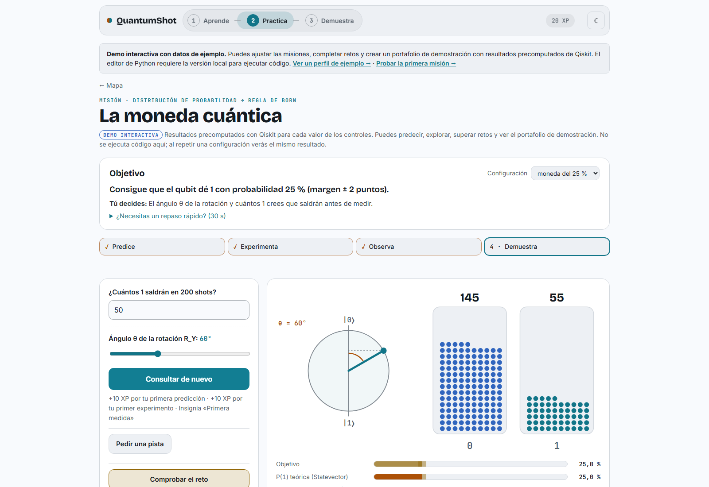

# QuantumShot · Del ML al QML

Tu dosis diaria de cuántica. QuantumShot enseña computación cuántica partiendo
de lo que ya sabes de estadística y machine learning: cada lección es un par,
una idea clásica y su gemela cuántica, y todo se comprueba con Qiskit.

Proyecto para el **Qiskit Fall Fest 2026**.

Las capturas se tomaron directamente de GitHub Pages el 25 de octubre de 2026.
La esfera de Bloch rota en la portada; los enlaces a las secciones se desplazan
suavemente y respetan la preferencia de movimiento reducido del navegador.

| Lección                              | Par clásico ↔ cuántico                                        |
| ------------------------------------ | ------------------------------------------------------------- |
| Monte Carlo ↔ shots                  | Regla de Born, frecuencias y error de muestreo                |
| SVM con kernel RBF ↔ kernel cuántico | Feature maps, solapamiento de estados y `QSVC` frente a `SVC` |

## Cómo usar la web

La web es un recorrido en tres pasos, **Aprende → Practica → Demuestra**, que
siempre ves en la barra superior con el paso en el que estás.

### 1. Empieza en la portada

La portada lee tu progreso y te muestra **un solo siguiente paso**, marcado como
«Tu siguiente paso», con su botón. Lo que todavía no toca aparece plegado y
explica cuándo se abre; si quieres verlo igual, pulsa «Echar un vistazo».
Mientras bajas, una barra fija repite lo que te toca hacer.

### 2. Aprende con las lecciones

Pulsa **Comenzar**. La lección avanza sola, con narración, animaciones y
subtítulos.

- **Muévete por la lección** con la línea de tiempo (haz clic en cualquier
  punto), los botones ⏮ ⏭, −5 y +5 segundos, y la velocidad.
- **Responde y predice.** Algunas pausas te piden apostar un resultado antes de
  verlo o contestar una pregunta.
- **Tu turno.** Las actividades se hacen con clic: lanzar monedas, mover el
  ángulo de un qubit, comparar kernels en un mapa. Al cumplir la meta, pulsa
  «Continuar»; también puedes pedir una pista o saltarla.
- **Programa.** Al final hay un ejercicio: completa el código y pulsa
  **Comprobar** para ejecutarlo con Qiskit. Si te atascas, usa las pistas.

### 3. Practica con las misiones

Abre **Practica** para ver el mapa de habilidades: arrástralo para moverte,
acércate con **Mayús + rueda** o con − y +, o cambia a la vista **Lista**. En
móvil, puedes pellizcar para acercar; el desplazamiento vertical de la página
sigue funcionando. Haz clic en una habilidad para ver su ficha y su misión.

Cada misión tiene cuatro pasos: **predice** el resultado, **experimenta**
(ajusta el circuito y consulta el resultado; Pages usa datos precomputados y la
versión local ejecuta Qiskit), **observa** qué salió y **demuestra** con
«Comprobar el reto». Al superarla ganas XP, insignias y una estrella en el mapa,
y se abren misiones nuevas.

### 4. Demuestra con tu portafolio

En **Demuestra** está tu portafolio: habilidades demostradas, lecciones
completadas, insignias y una evidencia por cada reto superado, con el problema,
lo que hiciste y el código para reproducirlo.

- **Editar perfil** cambia tu nombre, avatar y presentación.
- Marca **Mostrar en mi perfil público** en las evidencias que quieras enseñar y
  pulsa **Copiar enlace** para compartirlo.
- ¿Quieres ver cómo luce lleno? Abre «Ver un perfil de demostración» al pie de
  la página del juego.

### 5. Vuelve cada día

En la portada tienes un **reto del día** (la misma semilla para todos: predices
un número y consultas el resultado de Qiskit; en Pages está precomputado),
**preguntas de repaso** que vuelven a los 1, 3, 7 y 21 días, y tu **nivel** con
una racha.

### Atajos en las lecciones

| Tecla         | Acción                        |
| ------------- | ----------------------------- |
| Espacio       | Pausa o reproduce             |
| ← / →         | Paso anterior o siguiente     |
| Mayús + ← / → | Retrocede o avanza 5 segundos |
| C             | Muestra u oculta subtítulos   |
| A–F           | Elige una opción en preguntas |
| Intro         | Continúa tras responder       |

### Tu progreso

El progreso, tus borradores de código, tus reflexiones y las preferencias de
tema se guardan en el almacenamiento local de este navegador. No se sincronizan
con una cuenta. La demo pública tampoco envía el código que escribes en el
editor. Consulta el aviso de [Privacidad](site/privacidad.html).

Los experimentos corren en el simulador de Qiskit (`StatevectorSampler`), no en
hardware cuántico; cada misión lo indica.

## Para desarrolladores

Cómo correr la web en tu equipo, editar las lecciones y publicarla:
[docs/desarrollo.md](docs/desarrollo.md). Más detalles en
[Misiones, mapa y portafolio](docs/juego.md),
[Cómo escribir ejercicios](docs/exercises.md) y
[Arquitectura](docs/architecture.md).

## Equipo

- Rosario Aldava Asencios · Física, UNMSM
- Pedro Rojas Fernandez · Física, UNMSM
- Renzo Vega Martinez · Física, PUCP
- Fiorella Effio · Física, UNMSM

QuantumShot usa el motor de lecciones de
[qiskit-guides](https://github.com/PedroRojasF/qiskit-guides-compartido).

## Versión local y GitHub Pages

La versión local es la completa para practicar: `tools/serve.py` ejecuta en tu
equipo el código del editor con Qiskit, y el progreso queda en el navegador. En
Windows, **Ejecutar** funciona; la corrección automática por casos del editor
requiere Linux o macOS. El servidor local escucha solo en `127.0.0.1`.

[GitHub Pages](https://renzovega-creator.github.io/qiskit-fall-fest-2026-edtech/)
permite recorrer las lecciones y completar las cuatro misiones con resultados
precomputados de Qiskit. Cada valor de los controles tiene su resultado de
ejemplo; repetirlo devuelve el mismo dato. Los retos desbloquean el mapa y crean
evidencias marcadas como demostración, también al compartirlas. No ejecuta
Python ni tiene cuentas. El editor se puede leer y modificar, pero sus botones
de ejecución están desactivados y el código no se envía.

El
[perfil de ejemplo](https://renzovega-creator.github.io/qiskit-fall-fest-2026-edtech/juego.html#ejemplo)
muestra el portafolio lleno sin completar antes las misiones.

Para preparar la versión local y publicar una copia estática, sigue
[Desarrollo](docs/desarrollo.md). La documentación del Worker se conserva como
referencia técnica, pero no forma parte de la demo ni del despliegue actual.
