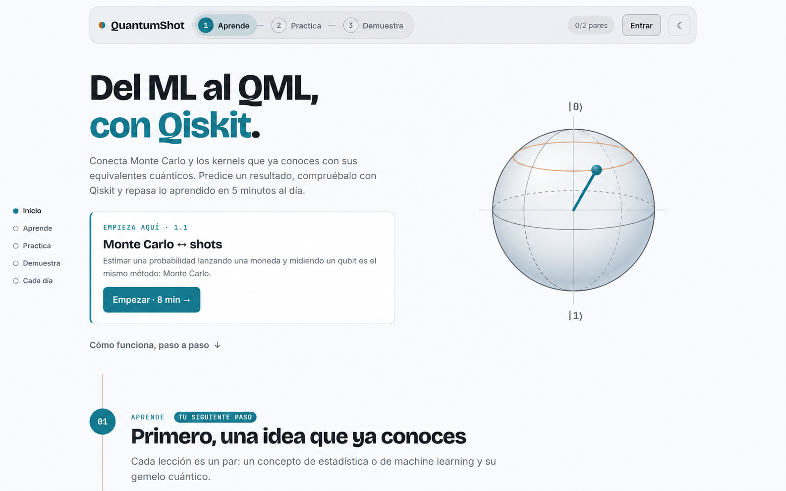
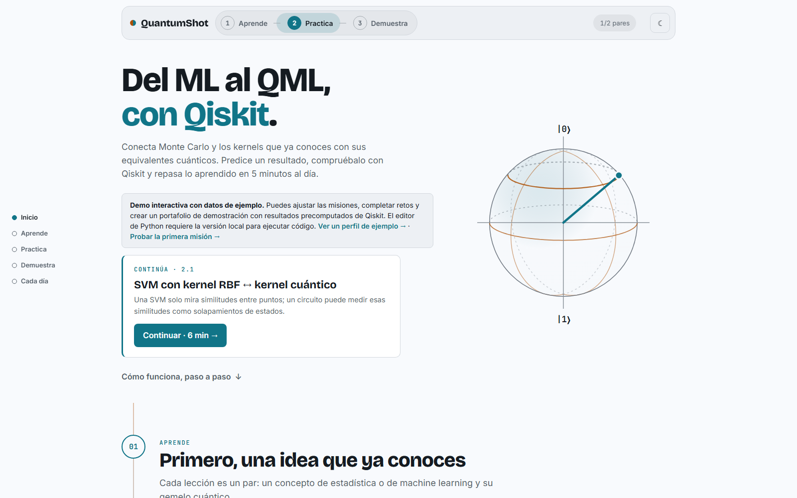
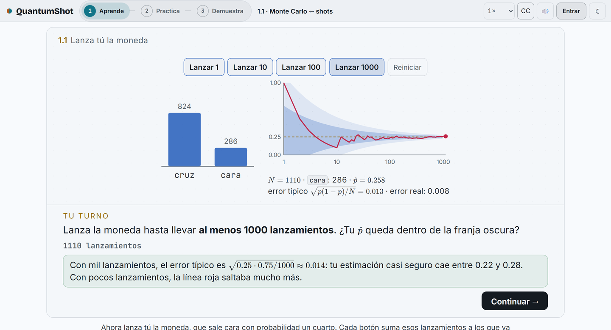
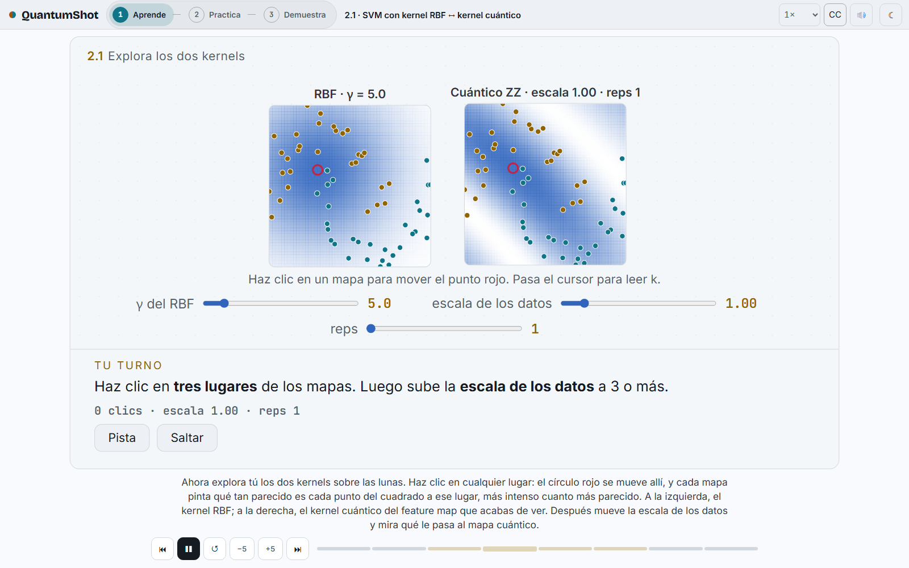
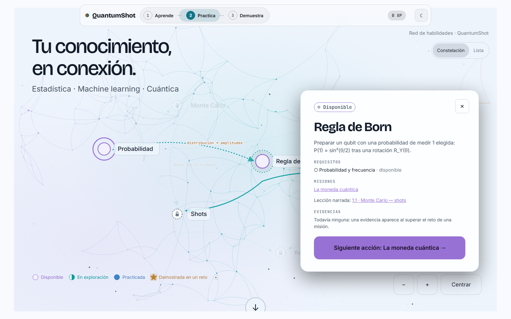
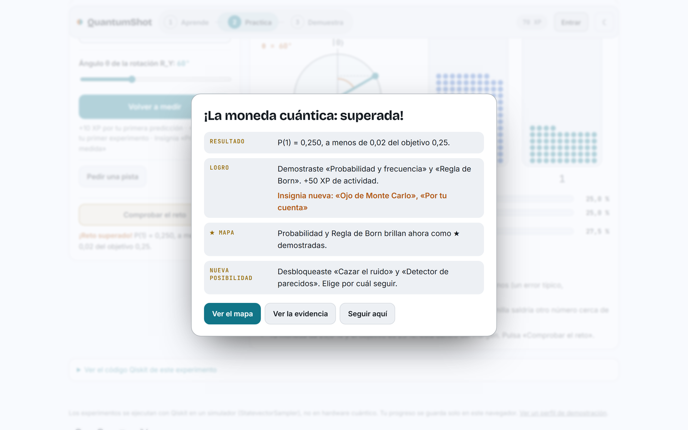
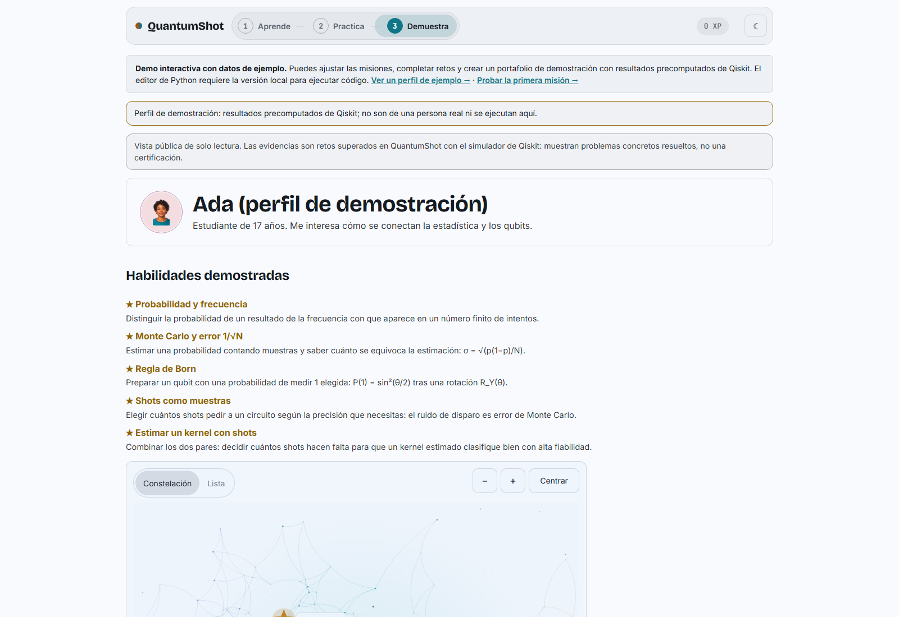
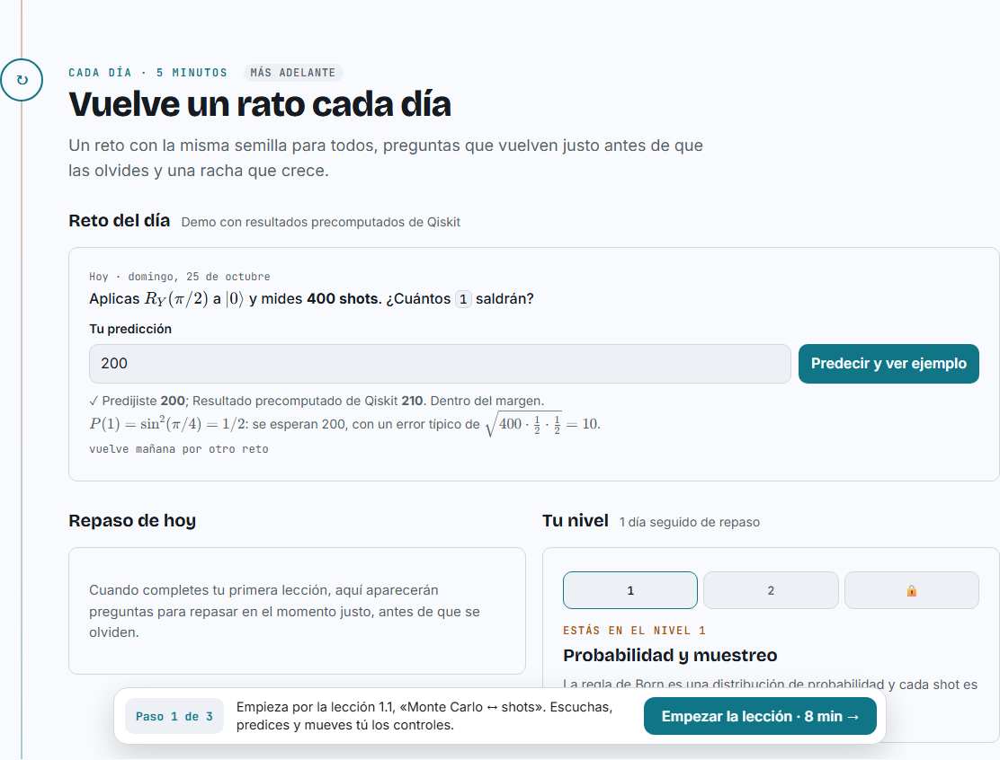

# QuantumShot · Del ML al QML

Tu dosis diaria de cuántica. QuantumShot enseña computación cuántica partiendo
de lo que ya sabes de estadística y machine learning: cada lección es un par,
una idea clásica y su gemela cuántica, y todo se comprueba con Qiskit.

Proyecto para el **Qiskit Fall Fest 2026**.

| Lección                              | Par clásico ↔ cuántico                                        |
| ------------------------------------ | ------------------------------------------------------------- |
| Monte Carlo ↔ shots                  | Regla de Born, frecuencias y error de muestreo                |
| SVM con kernel RBF ↔ kernel cuántico | Feature maps, solapamiento de estados y `QSVC` frente a `SVC` |

## Cómo usar la web

La web es un recorrido en tres pasos, **Aprende → Practica → Demuestra**, que
siempre ves en la barra superior con el paso en el que estás.

### 1. Empieza en la portada

La portada lee tu progreso y te muestra **un solo siguiente paso**, marcado como
«Tu siguiente paso», con su botón. Lo que todavía no toca aparece plegado y
explica cuándo se abre; si quieres verlo igual, pulsa «Echar un vistazo».
Mientras bajas, una barra fija repite lo que te toca hacer.

### 2. Aprende con las lecciones

Pulsa **Comenzar**. La lección avanza sola, con narración, animaciones y
subtítulos.

- **Muévete por la lección** con la línea de tiempo (haz clic en cualquier
  punto), los botones ⏮ ⏭, −5 y +5 segundos, y la velocidad.
- **Responde y predice.** Algunas pausas te piden apostar un resultado antes de
  verlo o contestar una pregunta.
- **Tu turno.** Las actividades se hacen con clic: lanzar monedas, mover el
  ángulo de un qubit, comparar kernels en un mapa. Al cumplir la meta, pulsa
  «Continuar»; también puedes pedir una pista o saltarla.
- **Programa.** Al final hay un ejercicio: completa el código y pulsa
  **Comprobar** para ejecutarlo con Qiskit. Si te atascas, usa las pistas.

### 3. Practica con las misiones

Abre **Practica** para ver el mapa de habilidades: arrástralo para moverte,
acércate con **Mayús + rueda** o con − y +, o cambia a la vista **Lista**.
En móvil, puedes pellizcar para acercar; el desplazamiento vertical de la página sigue funcionando. Haz clic en
una habilidad para ver su ficha y su misión.

Cada misión tiene cuatro pasos: **predice** el resultado, **experimenta**
(ajusta el circuito y pulsa «Medir con Qiskit»), **observa** qué salió y
**demuestra** con «Comprobar el reto». Al superarla ganas XP, insignias y una
estrella en el mapa, y se abren misiones nuevas.

### 4. Demuestra con tu portafolio

En **Demuestra** está tu portafolio: habilidades demostradas, lecciones
completadas, insignias y una evidencia por cada reto superado, con el problema,
lo que hiciste y el código para reproducirlo.

- **Editar perfil** cambia tu nombre, avatar y presentación.
- Marca **Mostrar en mi perfil público** en las evidencias que quieras enseñar y
  pulsa **Copiar enlace** para compartirlo.
- ¿Quieres ver cómo luce lleno? Abre «Ver un perfil de demostración» al pie de
  la página del juego.

### 5. Vuelve cada día

En la portada tienes un **reto del día** (la misma semilla para todos: predices
un número y Qiskit lo mide), **preguntas de repaso** que vuelven a los 1, 3, 7 y
21 días, y tu **nivel** con una racha.

### Atajos en las lecciones

| Tecla         | Acción                        |
| ------------- | ----------------------------- |
| Espacio       | Pausa o reproduce             |
| ← / →         | Paso anterior o siguiente     |
| Mayús + ← / → | Retrocede o avanza 5 segundos |
| C             | Muestra u oculta subtítulos   |
| A–F           | Elige una opción en preguntas |
| Intro         | Continúa tras responder       |

### Tu progreso

Tu progreso se guarda en este navegador. Con **Entrar** puedes guardarlo en una
cuenta, cuando la versión que usas tiene cuentas. El botón ☾ / ☀ cambia entre
modo claro y oscuro.

Los experimentos corren en el simulador de Qiskit (`StatevectorSampler`), no en
hardware cuántico; cada misión lo indica.

## Para desarrolladores

Cómo correr la web en tu equipo, editar las lecciones y publicarla:
[docs/desarrollo.md](docs/desarrollo.md). Más detalles en
[Misiones, mapa y portafolio](docs/juego.md),
[Cómo escribir ejercicios](docs/exercises.md) y
[Arquitectura](docs/architecture.md).

## Equipo

- Rosario Aldava Asencios · Física, UNMSM
- Pedro Rojas Fernandez · Física, UNMSM
- Renzo Vega Martinez · Física, PUCP
- Fiorella Effio · Física, UNMSM

QuantumShot usa el motor de lecciones de
[qiskit-guides](https://github.com/PedroRojasF/qiskit-guides-compartido).

## GitHub Pages y Cloudflare Workers

GitHub Pages publica la web estática: lecciones, animaciones y actividades que
se ejecutan en el navegador; el progreso se guarda en ese navegador. Por sí
solo, no ofrece cuentas ni permite ejecutar o corregir código con Qiskit en el
servidor.

Para esas funciones se necesita un backend. El Cloudflare Worker del proyecto
atiende las cuentas y el progreso sincronizado, y recibe los ejercicios para
que un contenedor aislado los ejecute con Qiskit. El Worker también puede servir
los archivos de la web, manteniendo la página y el backend en el mismo origen.

Para el despliegue completo hacen falta:

- Una cuenta Cloudflare con Workers Paid (base de 5 USD/mes; Containers puede
  generar cargos de uso adicionales y no hay un tope automático de factura).
- `mise`, `bun` y Docker para construir el contenedor; Docker puede ejecutarse
  en el equipo local o en un runner de CI.
- Un Worker, una base D1 con el esquema del proyecto y un widget Turnstile para
  el host publicado.
- Clientes OAuth de Google y GitHub, con sus URLs de retorno configuradas, si se
  habilitan las cuentas.
- Para CI, un token de Cloudflare y el Account ID; además, los secretos de
  Turnstile y OAuth, guardados fuera del repositorio (por ejemplo, en GitHub
  Actions Secrets). En un despliegue local se puede autenticar con
  `cf auth login`.

La publicación en Pages y el despliegue completo del Worker se explican en
[Desarrollo](docs/desarrollo.md) y [Desplegar tu propia copia](docs/deploy.md).
Conectar Pages a un Worker separado requiere adaptar las rutas y la
configuración de origen; no basta con cambiar una URL.
